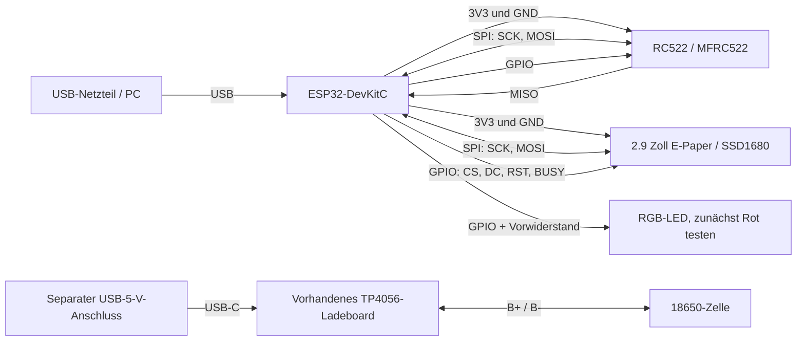

# Verdrahtungsskizze – Erstaufbau mit vorhandener Hardware

**Stand:** 16.10.2026  
**Zweck:** sichere Tischverdrahtung zum Testen von ESP32, E-Paper, RC522 und RGB-LED. Das ist noch kein Akku-USV-Schaltplan.

## Übersicht

Die beiden USB-Anschlüsse stellen im Erstaufbau zwei getrennte Funktionen bereit: Das DevKit versorgt das laufende Terminal; das TP4056 lädt die Zelle. **OUT+ und OUT− des TP4056 bleiben unverbunden.** Damit gibt es noch keinen Akku-Notbetrieb. Beim Abziehen des DevKit-USBs geht das Terminal aus.

## Anschlüsse

Alle GPIO-Vorschläge beziehen sich auf das vorhandene ESP32-DevKitC-Symbol und vermeiden die im Firmwarecode bereits belegten E-Paper-Pins. Vor dem Löten die Beschriftung des konkreten DevKit und die Steckerreihenfolge der Module mit den Fotos/Datenblättern abgleichen.

### MFRC522 an ESP32 anschließen

| MFRC522-Modul | Header-Pin | ESP32-DevKitC |
|---|---:|---|
| `SDA` / `SS` (Chip Select) | 1 | GPIO27 |
| `SCK` | 2 | GPIO18 (`SCK`) |
| `MOSI` | 3 | GPIO23 (`MOSI`) |
| `MISO` | 4 | GPIO19 (`MISO`) |
| `IRQ` | 5 | Nicht anschließen |
| `GND` | 6 | `GND` |
| `RST` | 7 | GPIO26 |
| `3.3V` | 8 | `3V3` |

Die Nummern 1–8 des MFRC522-Headers gelten mit der Antennenseite nach vorn und der Pinleiste oben, von links nach rechts; vor dem Stecken trotzdem die Silkscreen-Aufdrucke auf dem eigenen Modul kontrollieren. Der MFRC522-Aufdruck `SDA` meint bei der SPI-Verdrahtung Chip Select, nicht den I²C-Datenbus. Das E-Paper verwendet GPIO18/23 gemeinsam für `CLK`/`DIN`; seine übrigen Anschlüsse sind `CS` → GPIO5, `DC` → GPIO17, `RST` → GPIO16, `BUSY` → GPIO4, `VCC` → `3V3` und `GND` → `GND`. Die vorhandene Display-Firmware konfiguriert den SPI-Bus derzeit mit `MISO = -1`; für den MFRC522 muss der gemeinsame Bus in der Firmware zusätzlich GPIO19 als MISO verwenden und der Leser als eigenes SPI-Gerät mit separatem Chip-Select registriert werden. Die Verdrahtung allein aktiviert den NFC-Leser also noch nicht. Die E-Paper-Stecker-Pinnummern hängen von der konkreten Breakout-Platine ab; hier sind daher bewusst deren Signalsilkscreens statt einer geratenen Nummerierung angegeben.

### RGB-LED

Die vorhandene Kingbright L-154A4SURKQBDZGC ist eine RGB-LED mit gemeinsamer Kathode. Pin 2 (gemeinsame Kathode) an `GND`; Pin 1 (rot) über einen Vorwiderstand von zunächst 470 Ω an ESP32-GPIO13. Jeder Farbanschluss braucht seinen eigenen Vorwiderstand. Die Pinbelegung gilt bei Ansicht von unten auf die Anschlussdrähte gemäß LED-Datenblatt; das Gehäuse und die abgeflachte Seite nicht als alleinige Orientierung verwenden.

Pin 3 ist Blau und Pin 4 Grün. Das Datenblatt nennt für Blau und Grün jeweils etwa 3,3 V typische Durchlassspannung. Diese Farben haben an einer 3,3-V-GPIO-Versorgung praktisch keine Reserve für einen sinnvollen Vorwiderstand. Blau und Grün deshalb vorerst nicht direkt an GPIOs anschließen; dafür braucht es eine passende Treiberschaltung und Versorgung. Die LED-Pinnummerierung ist im Datenblatt auf der Gehäusezeichnung angegeben.

## Taster-Pinplan (Vorschlag, falls die vorhandenen Taster verwendet werden)

Alle Taster schalten den jeweiligen ESP32-Eingang gegen `GND` (aktiv LOW). GPIO34, GPIO35, GPIO36 und GPIO39 sind nur Eingänge und haben keine internen Pull-ups; deshalb pro Eingang einen externen 10-kΩ-Widerstand nach `3V3` vorsehen.

| Funktion | ESP32-GPIO | Beschaltung |
|---|---:|---|
| Dienstbeginn | GPIO34 | Taster nach GND, 10 kΩ Pull-up nach 3V3 |
| Dienstende | GPIO35 | Taster nach GND, 10 kΩ Pull-up nach 3V3 |
| Pausenbeginn | GPIO36 | Taster nach GND, 10 kΩ Pull-up nach 3V3 |
| Pausenende | GPIO39 | Taster nach GND, 10 kΩ Pull-up nach 3V3 |

Das sind GPIO-Nummern des ESP32, keine festen Lochpositionen auf der DevKit-Stiftleiste. Für physische Header-Positionen brauchen wir die genaue DevKitC-Version bzw. deren Pinout.

### Akku und Ladeplatine

| TP4056-Anschluss | Verbindung im Erstaufbau |
|---|---|
| USB-C | Separater USB-5-V-Eingang zum Laden |
| `B+`, `B-` | Plus und Minus der einzelnen 18650-Zelle |
| `OUT+`, `OUT-` | **Nicht mit ESP32, dessen 3V3-Pin oder Peripherie verbinden** |

Das TP4056-Board hat Zellschutz, aber keinen nachgewiesenen Power-Path. Ein gemeinsam angeschlossener Verbraucher kann den Ladeabschluss verfälschen. Die vorhandenen AMS1117-Module sind in dieser Skizze nicht angeschlossen: Sie sind kein geeigneter Regler für den gesamten Einzellen-Akku-Bereich und dürfen nicht parallel zur USB-Versorgung am `3V3`-Pin des DevKits liegen.

## Noch nicht verdrahtet

- Vier Bedientaster und ihre Leuchtanzeigen; die Einkaufsliste führt sie als noch festzulegende Teile.
- Piezo-Buzzer und dessen Treiber.
- Akkuversorgung des Terminals sowie Betrieb aus Akku und Laden über einen einzelnen Geräteeingang. Dafür fehlt ein passendes Lade-/Power-Path- und Versorgungskonzept.
- Anschluss des konkreten E-Paper-Breakouts: `VCC`-Spannungsbereich und Pinreihenfolge am Modul prüfen.

## Verbindliche Vorsicht für den Ersttest

1. DevKit ausschließlich über USB versorgen. Nicht gleichzeitig einen externen Regler an `3V3` anschließen.
2. Peripherie zunächst aus dem `3V3`-Pin des DevKits versorgen und nur bei stabiler Versorgung weiter testen.
3. TP4056-Ausgang vom ESP32 getrennt lassen. Vor dem Verbinden einer anderen Akkuversorgung muss ein Schaltplan mit explizitem Power-Path und Zellschutz feststehen.
4. Vor dem Einschalten Versorgungspolarität und Modul-Pinout mit dem Multimeter kontrollieren.
